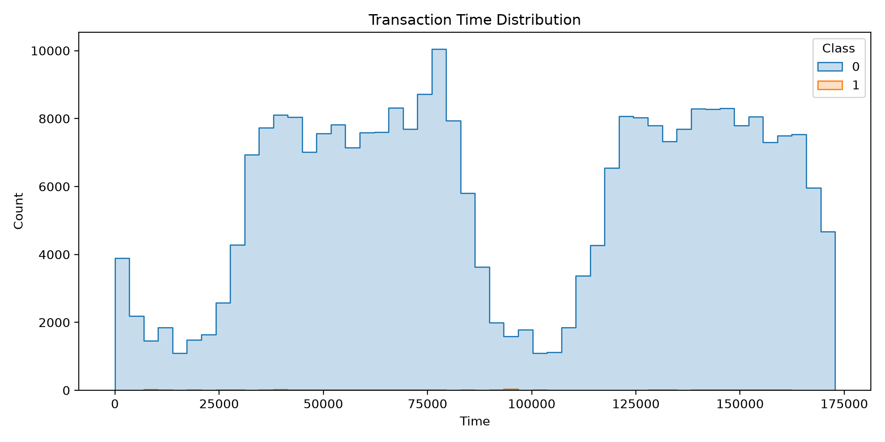

# 💳 Credit Card Fraud Detection Using Artificial Neural Network (ANN)

## 📌 Project Overview
This project focuses on detecting potentially fraudulent credit card transactions using Machine Learning and Artificial Neural Networks (ANN). It analyzes transaction data to identify patterns and distinguish fraudulent transactions from genuine transactions.

## 🎯 Project Objectives
- Analyze credit card transaction data.
- Perform data cleaning and preprocessing.
- Explore transaction patterns through Exploratory Data Analysis (EDA).
- Build a machine learning-based fraud detection model.
- Evaluate model performance using classification metrics.
- Visualize important findings and model results.

## 🛠️ Technologies Used
- Python
- Artificial Neural Networks (ANN)
- Scikit-learn
- Pandas and NumPy
- Matplotlib and Seaborn
- Jupyter Notebook / Google Colab
- Power BI

## 📂 Repository Structure
- Credit_Card_Fraud_Detection.ipynb – Project notebook
- credit_card_fraud_detection.ipynb – Fraud detection analysis notebook
- fraud_dashboard.pbix – Power BI dashboard
- requirements.txt – Python dependencies
- 01_fraud_vs_genuine.png – Fraud vs genuine transactions
- 02_amount_by_class.png – Transaction amount analysis
- 03_transaction_time.png – Transaction time analysis
- 04_correlation_heatmap.png – Correlation analysis
- 05_random_forest_confusion_matrix.png – Confusion matrix visualization
- 06_roc_curve.png – ROC curve visualization
- 07_feature_importance.png – Feature importance visualization

## 🔍 Project Workflow
1. Data collection and loading
2. Data preprocessing and cleaning
3. Exploratory Data Analysis (EDA)
4. Feature preparation
5. Model development using ANN
6. Model evaluation
7. Data visualization and dashboard creation

## 📊 Project Visualizations

### Fraud vs Genuine Transactions


### Transaction Amount by Class


### Transaction Time Analysis


### Correlation Heatmap


### Confusion Matrix


### ROC Curve


### Feature Importance


## 📈 Model Evaluation
The model performance is evaluated using classification metrics such as:
- Accuracy
- Precision
- Recall
- F1-Score
- Confusion Matrix
- ROC-AUC Score

Refer to the project notebooks for the actual model results.

## ⚙️ How to Run the Project

1. Clone this repository:
   ```bash
   git clone https://github.com/KirtiMBA0910/Credit-card-fraud-detection-ANN.git
   ```

2. Open the project folder.

3. Install the required dependencies:
   ```bash
   pip install -r requirements.txt
   ```

4. Open Jupyter Notebook:
   ```bash
   jupyter notebook
   ```

5. Open the project notebook and run the cells.

## 💡 Project Outcome
This project demonstrates how machine learning techniques can be applied to financial transaction data to identify suspicious activities. It provides practical experience in data preprocessing, model development, evaluation, and visualization.

## 👩‍💻 Author
**Kirti Rajput**

MBA – Data Science & Artificial Intelligence

GitHub: [KirtiMBA0910](https://github.com/KirtiMBA0910)
